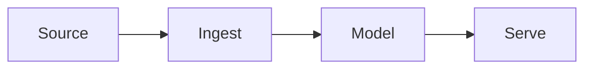

This is a sample. It exists to show the structure: each folder under `log/research/` is a category in the sidebar (named in its `_category_.json`), and each page can carry code and diagrams. Pages with `draft: true` are hidden in production builds, so delete this file once there is a real page.

## Diagram



## Code

```python
def transform(rows: list[dict]) -> list[dict]:
    """Keep the raw data; model it later."""
    return [row for row in rows if row.get("id")]
```
